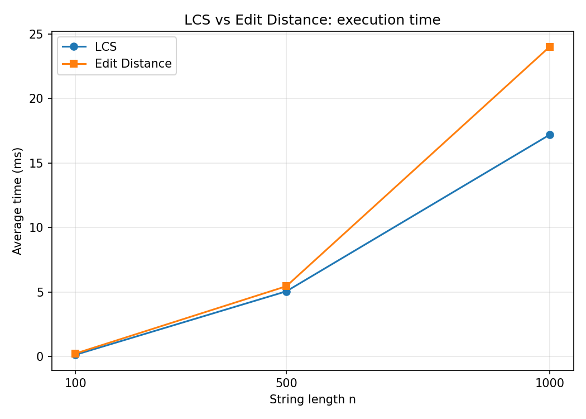
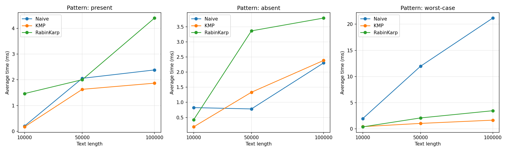
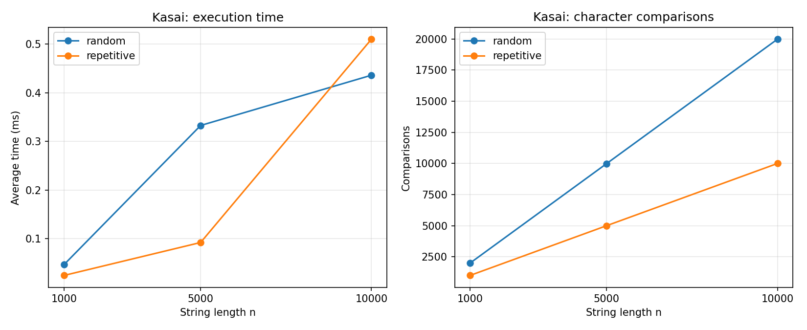

# Assignment 4: Text analysis, dynamic programming and string algorithms

Java code for LCS and edit distance (dynamic programming), naive / KMP / Rabin–Karp
string matching, and Kasai's LCP algorithm, plus the experiments that compare them.

## Build and run

You need JDK 17 or newer (I used OpenJDK 25). From the repository root:

```bash
mkdir out
javac -d out $(find src -name "*.java")

java -cp out tests.AllTests
java -cp out bench.DpBenchmark
java -cp out bench.MatchingBenchmark
java -cp out bench.KasaiBenchmark
```

In PowerShell the compile line is `javac -d out (Get-ChildItem -Recurse -Filter *.java src).FullName`.
Each benchmark writes a CSV file into `results/tables/`. The plots in `results/plots/`
were drawn with Python (matplotlib) from those CSV files.

```
src/dp/        LCS, EditDistance
src/matching/  StringMatcher, NaiveMatcher, KMPMatcher, RabinKarpMatcher
src/suffix/    SuffixArray (simple builder), Kasai
src/util/      StringGenerator
src/bench/     DpBenchmark, MatchingBenchmark, KasaiBenchmark
src/tests/     AllTests and the test classes
results/tables/  CSV files with the measured results
results/plots/   PNG plots
```

---

## 1. Problem description and algorithm overview

LCS returns the length of the longest subsequence that two strings share. Edit distance
is the smallest number of insertions, deletions and substitutions (cost 1 each) that turn
one string into the other. For string matching, the task is to return every start index
of a pattern in a text, including overlapping matches. Kasai's algorithm builds the LCP
array of a string from its suffix array.

### LCS

`dp[i][j]` is the LCS length of the first `i` characters of `a` and the first `j` of `b`.
If either prefix is empty the answer is 0. If `a[i-1] == b[j-1]`, then
`dp[i][j] = dp[i-1][j-1] + 1`: matching the two last characters never hurts, so the
answer is one more than for the shorter prefixes. Otherwise at least one of the two last
characters is not in the subsequence, so `dp[i][j] = max(dp[i-1][j], dp[i][j-1])`.
Each cell only needs cells with smaller indices, so filling the table row by row works.

### Edit distance

`dp[i][j]` is the cost of turning the first `i` characters of `a` into the first `j` of `b`.
The base cases are `dp[i][0] = i` (delete everything) and `dp[0][j] = j` (insert
everything). If the last characters are equal, `dp[i][j] = dp[i-1][j-1]`. Otherwise
`dp[i][j] = 1 + min(dp[i-1][j-1], dp[i-1][j], dp[i][j-1])`, which are substitution,
deletion and insertion. This covers every way the ends of the two prefixes can line up,
and what is left is the same problem on shorter prefixes.

### KMP

The LPS table stores, for each position `i`, the length of the longest proper prefix of
`pattern[0..i]` that is also a suffix of it. When a mismatch happens after `j` characters
matched, the last `lps[j-1]` of them are already equal to the start of the pattern, so
the search continues with `j = lps[j-1]` and the text index stays where it is. The text
index never goes back, and `j` can only drop as often as it has gone up, so the search
takes at most about `2n` steps.

### Rabin–Karp

The hash of a window is updated as `h = ((h - out * B^(m-1)) * B + in) mod M`, with
`B = 256` and `M = 1_000_000_007`. When the window hash equals the pattern hash, the
characters are compared one by one, and the index is reported only if they are really
equal. A collision therefore costs time but cannot give a wrong answer. I count these
false alarms as spurious hits.

### Kasai and the LCP array

`lcp[i]` is the length of the longest common prefix of the suffixes starting at `sa[i-1]`
and `sa[i]` (neighbours in sorted order), and `lcp[0] = 0`. Kasai goes through the
suffixes in text order and keeps the current prefix length `h`. If suffix `i` shares `h`
characters with its predecessor in the suffix array, suffix `i+1` shares at least `h - 1`
with its own predecessor, so `h` is reduced by at most 1 per step and not restarted from
zero. `h` never exceeds `n` and goes down at most `n` times, so it goes up at most `2n`
times. Each position also adds at most one failed comparison, so the total is at most `3n`.

---

## 2. Implementation decisions and assumptions

- All random strings use the alphabet `ACGT`. The worst-case matching input is the text
  `A^n` with the pattern `A^19 B`; `B` is outside the alphabet on purpose.
- An empty pattern returns an empty list in all three matchers (naive and Rabin–Karp
  would otherwise return every index). A pattern longer than the text also returns an
  empty list. Overlapping matches are all reported.
- Empty strings are valid input for LCS and edit distance.
- `null` arguments throw `IllegalArgumentException`. Kasai also rejects a suffix array
  with the wrong length or an index out of range.
- The suffix array is built by sorting suffixes with a comparison sort (worst case
  O(n² log n)), which the assignment allows. It is built before timing and is not part
  of Kasai's measured time.
- A comparison is one comparison of two characters. For Rabin–Karp only the checks
  after a hash hit are counted, not the hash arithmetic, so its numbers cannot be
  compared directly with naive and KMP. The counters sit inside the timed region and add
  a small overhead.
- The DP code keeps the full table because `LCS.subsequence` needs it. Two rows would be
  enough if only the value was needed.
- Only the standard library is used (collections, `Random`, sorting, timing).

---

## 3. Complexity analysis

`n` is the text length (or length of the first string), `m` the pattern length (or length
of the second string).

| Algorithm | Main operation | Best case | Worst case | Extra space | Why |
|---|---|---|---|---|---|
| LCS | `dp[i][j] = dp[i-1][j-1] + 1` if equal, else `max(dp[i-1][j], dp[i][j-1])` | Θ(n·m) | Θ(n·m) | O(n·m) | (n+1)(m+1) cells, constant work per cell, no early exit |
| Edit distance | `dp[i][j] = dp[i-1][j-1]` if equal, else `1 + min` of three neighbours | Θ(n·m) | Θ(n·m) | O(n·m) | same table, always filled completely |
| Naive | compare the pattern at every shift | O(n) | O(n·m) | O(1) | best: first character fails at every shift; worst: long partial matches at every shift (`a^n` with `a^(m-1)b`) |
| KMP | build LPS, on mismatch `j = lps[j-1]` | Θ(n + m) | Θ(n + m) | O(m) | LPS takes O(m), the text index never moves back |
| Rabin–Karp | rolling hash, verify when hashes are equal | O(n + m) expected | O(n·m) | O(1) | with a large modulus collisions are rare; many hash hits or true matches (`a^n` with `a^m`) cost O(m) each |
| Kasai | keep `h`, `lcp[rank[i+1]] >= lcp[rank[i]] - 1` | Θ(n) | Θ(n) | O(n) | `rank` and `lcp` arrays; `h` goes up at most 2n times |

The table gives bounds on the number of operations. What I measure is the number of
comparisons and the wall-clock time, and the time also contains constants that Big-O
leaves out (modular arithmetic, memory access, JIT, garbage collection). Rabin–Karp is
expected linear but has a bigger constant per character. Its O(n·m) case was not part of
the experiments.

---

## 4. Testing

`tests.AllTests` is a small test runner without JUnit. It prints PASS or FAIL for each
case, and all of them pass.

- LCS: identical strings, completely different strings, empty strings, two textbook
  pairs, symmetry, the reconstructed subsequence, `null` input.
- Edit distance: identical strings, empty strings, one substitution, one insertion, one
  deletion, kitten/sitting and a few other known pairs, symmetry, `null` input.
- Matching: pattern at the start, middle and end, overlapping occurrences, absent
  pattern, pattern longer than the text, pattern equal to the text, empty pattern, empty
  text. In every case naive, KMP and Rabin–Karp have to return the same list. I also run
  500 random cases over `AB` for all three, and 500 cases where Rabin–Karp uses base 3
  and modulus 7 so that collisions are frequent.
- KMP table: four tables computed by hand.
- Counters: exact naive counts on small inputs, naive worst case `(n-m+1)·m`, KMP below
  `2n`, spurious hits with a weak hash.
- Kasai: `banana` with the suffix array `[5, 3, 1, 0, 4, 2]` and LCP `[0, 1, 3, 0, 0, 2]`
  worked out by hand, then `abracadabra`, `aaaa`, a single character, the empty string,
  bad arguments, and 300 random strings checked against a brute-force LCP (including the
  `3n` bound on comparisons).

---

## 5. Experimental setup

Machine: `AMD Ryzen 3550H, 8Gb RAM`, Windows, OpenJDK 25.0.1.

Strings are random over `ACGT`. Each benchmark has one `Random` with seed 42, and all
inputs are generated before any timing starts.

| Experiment | Input sizes |
|---|---|
| LCS, edit distance | two strings of length 100, 500, 1000 |
| String matching | text length 10 000, 50 000, 100 000, pattern length 20 |
| Kasai | string length 1 000, 5 000, 10 000 |

For matching there are three scenarios, and naive, KMP and Rabin–Karp get the same text
and pattern in each one:

- `present`: the pattern is copied from the middle of the text (one occurrence);
- `absent`: a random pattern that I checked does not occur;
- `worst-case`: text `A^n`, pattern `A^19 B`.

The benchmark compares the three result lists and stops if they differ. Kasai is run on a
random string and on `A^n`.

Timing uses `System.nanoTime()` around the algorithm call only. Generating inputs,
printing and writing files are outside the timed part. Every measurement is repeated
5 times and the average is reported. Before timing there is a warm-up, so the first
measurements are not dominated by JIT compilation, and results are stored in a
`volatile` field so the calls are not optimised away. I record table cells for the DP
algorithms, character comparisons for matching and Kasai, and spurious hash hits for
Rabin–Karp. The raw data is in `results/tables/dp_results.csv`, `results/tables/matching_results.csv`
and `results/tables/kasai_results.csv`. Times change from machine to machine, comparison counts
do not.

---

## 6. Results

### LCS and edit distance

| n | LCS (ms) | Edit distance (ms) | Table cells | LCS length | Edit distance |
|---|---|---|---|---|---|
| 100 | 0.1487 | 0.2480 | 10 201 | 64 | 55 |
| 500 | 5.0614 | 5.4573 | 251 001 | 326 | 267 |
| 1000 | 17.1979 | 24.0173 | 1 002 001 | 648 | 521 |



### String matching (time in ms / character comparisons)

| Scenario | Text length | Naive | KMP | Rabin–Karp |
|---|---|---|---|---|
| present | 10 000 | 0.2043 / 13 433 | 0.1731 / 12 521 | 1.4659 / 20 |
| absent | 10 000 | 0.8256 / 13 376 | 0.1882 / 12 528 | 0.4229 / 0 |
| worst-case | 10 000 | 1.9631 / 199 620 | 0.4279 / 19 981 | 0.3804 / 0 |
| present | 50 000 | 2.0587 / 66 562 | 1.6313 / 62 388 | 2.0048 / 20 |
| absent | 50 000 | 0.7821 / 66 627 | 1.3337 / 62 407 | 3.3646 / 0 |
| worst-case | 50 000 | 11.9674 / 999 620 | 1.0446 / 99 981 | 2.0896 / 0 |
| present | 100 000 | 2.3837 / 133 426 | 1.8698 / 125 069 | 4.3980 / 20 |
| absent | 100 000 | 2.3047 / 133 476 | 2.3868 / 123 484 | 3.7886 / 0 |
| worst-case | 100 000 | 21.1750 / 1 999 620 | 1.6635 / 199 981 | 3.4659 / 0 |

All runs had 0 spurious hash hits. All three algorithms found 1 match in `present` and
none in the other two scenarios.



### Kasai

| Scenario | n | Time (ms) | Comparisons | Comparisons / n |
|---|---|---|---|---|
| random | 1 000 | 0.0469 | 1 990 | 1.99 |
| repetitive | 1 000 | 0.0247 | 999 | 1.00 |
| random | 5 000 | 0.3327 | 9 991 | 2.00 |
| repetitive | 5 000 | 0.0924 | 4 999 | 1.00 |
| random | 10 000 | 0.4359 | 19 988 | 2.00 |
| repetitive | 10 000 | 0.5099 | 9 999 | 1.00 |



---

## 7. Discussion

### DP

Both algorithms fill (n+1)² cells, so the time should grow roughly like n². From 500 to
1000 the number of cells goes up 3.99 times and the time goes up 3.4 times for LCS and
4.4 times for edit distance, which is close to what the theory says. From 100 to 500 the
cells grow 24.6 times and the time grows 34 times for LCS and 22 times for edit
distance. At n = 100 a run takes a fraction of a millisecond, so JIT state, caches and
timer resolution matter a lot and I would not read much into that ratio. Edit distance is
about 1.4 times slower than LCS at n = 1000. I did not profile it. The three-way minimum
in every cell and the extra base row and column are the obvious candidates.

### String matching

The comparison counts agree with the theory. On the worst-case input naive does exactly
`(n-m+1)·m` comparisons: 9 981 · 20 = 199 620 at n = 10 000, and the same formula gives
999 620 and 1 999 620 for the larger texts. The time shows it too, 21.2 ms at
n = 100 000 against 1.7 ms for KMP. KMP needs 19 981, 99 981 and 199 981 comparisons
there, which is `2n - 19` and stays under the `2n` bound.

On random text over four letters most shifts fail on the first or second character. Naive
makes about 4/3 comparisons per shift (13 433 at n = 10 000) and KMP between `n` and
`2n`, so the two are close, and KMP only pulls clearly ahead on repetitive input.

Rabin–Karp's counter is tiny (20 when the pattern is present, otherwise 0) because only
the checks after a hash hit are counted, and with modulus 10⁹ + 7 there were no spurious
hits. Its real cost is in the time. In four of the six present/absent rows it is the
slowest of the three, since it does a modular multiplication and subtraction for every
text character. It is fast on the worst-case input (3.5 ms at n = 100 000, against 21 ms
for naive) because the window hash never equals the hash of `A^19 B`. The actual worst
case for Rabin–Karp, `a^n` with `a^m`, where every window is a true match, was not
tested.

Most of these timings are around 1 ms, where a single GC pause or JIT event moves the
number visibly. Naive on `absent` at n = 50 000 took 0.78 ms and on `present` 2.06 ms,
although the comparison counts are almost the same (66 627 and 66 562). Rabin–Karp
`present` at n = 10 000 (1.47 ms) against `absent` (0.42 ms) is another example. For the
asymptotic claims I trust the comparison counts more than the times, and I only use the
times for the overall trend.

### Kasai

The number of comparisons is about 2n for random strings (1.99 to 2.00 per character) and
about n for repetitive ones. It stays below the 3n bound and doubles when n doubles, so
the growth is linear. The times are noisy at this size: the repetitive string at
n = 10 000 takes 0.51 ms, more than the random one, even though it makes half as many
comparisons. Here too the counts are the better evidence.

---

## 8. Conclusion

- LCS and edit distance have the same time and space cost and differ only in the
  recurrence. Edit distance was a bit slower in my runs.
- Naive needs no preprocessing and no extra memory and is fine on random text, but it
  takes O(n·m) on repetitive input.
- KMP needs O(m) memory for the LPS table and in return guarantees O(n + m) whatever the
  input. It is the one to pick when the worst case matters.
- Rabin–Karp needs O(1) extra memory, is linear in expectation and is easy to extend to
  several patterns. It does more work per character, depends on the hash parameters and
  has an O(n·m) worst case. Because every hash hit is verified, its answers are always
  correct.
- Kasai is linear once the suffix array exists. The cost of getting LCP information is
  therefore set by building the suffix array, and the simple sort I used is only good for
  small inputs.
- The comparison counts follow the theory closely. At millisecond scale the times mostly
  reflect constants and noise.
